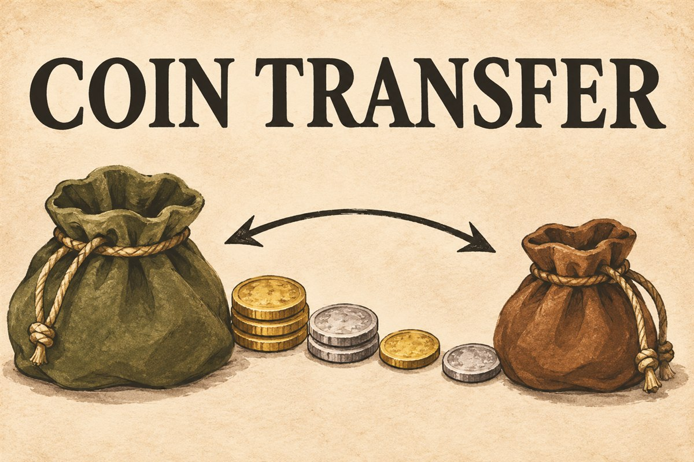
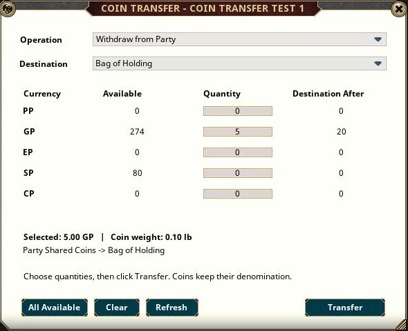
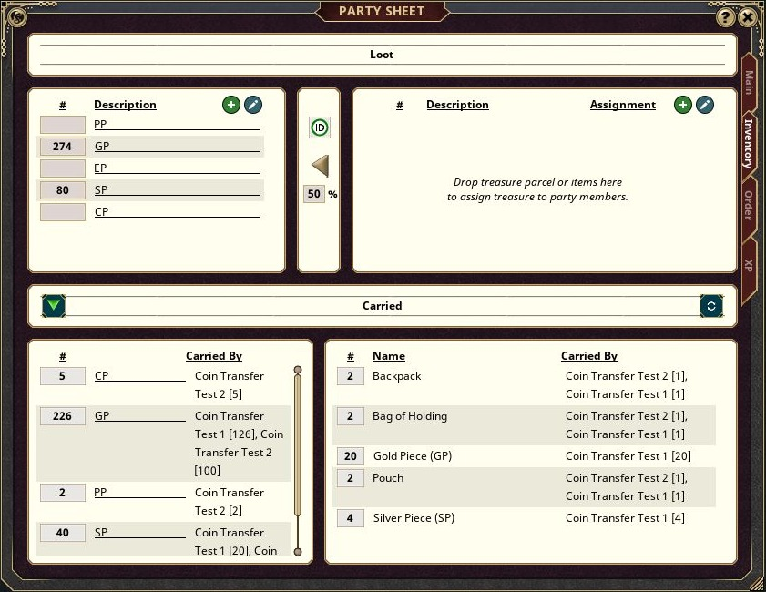

# Coin Transfer

Keep a common fund for supplies, pool loot after an adventure, and let players withdraw or return coins through their own character sheets. When the hoard gets heavy, turn Treasure balances into physical coin items and move them into a Bag of Holding; pair with Extraplanar Containers for its supported weight exemption. The English interface remembers the last operation and container.

[Download v0.1.4](https://github.com/alperozisik/FG-CoinTransfer/releases/tag/v0.1.4) · [Report an issue](https://github.com/alperozisik/FG-CoinTransfer/issues) · [Screenshot gallery](docs/forge/images/README.md)

Forge publication is pending; the current download is the public GitHub Release.

*Illustrative cover artwork; the actual Fantasy Grounds interface is shown below.*

## Requirements

- Fantasy Grounds with the **5E ruleset**, with Coin Transfer enabled by the host.
- For player party transfers: a connected host, an owned character on the Party Sheet, and enough money at the source. Shared party coins are player-visible.
- For physical coin transfers with MNM Coin Manager/Upgrade: disable MNM's inventory coin mirroring option. Containers must have unique names and quantity one.

Separate 2014/2024 configurations and other-extension combinations are unverified for v0.1.4; see [tested environment and support limits](#tested-environment-and-support-limits).

## One party, one shared purse

Pool adventure loot and player contributions in the Party Sheet's shared Loot coins. A character can withdraw money for supplies, then deposit the unused coins back through their own sheet. For example, starting with **300 GP**, a **25 GP** withdrawal leaves **275 GP** in the shared pool; returning **10 GP** brings it to **285 GP**. Another character's **20 GP** contribution brings the common fund to **305 GP**.

Party transfers use the connected host's balance and membership checks and require no separate GM distribution or approval click. The shared pool is not a character's carried balance: moving money between them changes where it is held, without adding it twice. GP stays GP and SP stays SP; currency exchange, shops and banking are outside the scope.

## First transfer

1. Install the extension using the steps below and open your character's **Inventory** tab.
2. Click **Coin Transfer**, choose **Withdraw from Party**, and select Treasure > Coins or a container such as Bag of Holding.
3. Enter whole coin quantities, review **Destination After** and the weight, then click **Transfer**.

The host validates membership and balances automatically. Each denomination stays the same. Use **Deposit to Party** to return money to the shared pool.

The button is also added to Floating Tabs inventory. Players can use `/cointransfer` with an active identity; the GM can use `/cointransfer <character name>`.

## Four operations

- **Withdraw from Party:** take shared Party Sheet coins into Treasure > Coins, loose inventory, or a container.
- **Deposit to Party:** return Treasure coins or physical coin items to the shared Party Sheet pool.
- **Coins -> Items:** remove Treasure coins and create the corresponding inventory quantities.
- **Items -> Coins:** remove physical quantities and credit Treasure coins.

Select whole coin quantities and click **Transfer**. The last operation and container are saved per character. A missing or ambiguous container must be selected again. Container stacks must have quantity 1 and unique names.

## From heavy hoard to Bag of Holding

At a campaign weight of **0.02 lb per coin**, 4,000 GP weighs **80 lb**. Choose **Coins -> Items** and select your Bag of Holding to move existing Treasure GP into it, or **Withdraw from Party** to send shared loot directly to the bag. The coins become normal inventory stacks with quantity, monetary cost and unit weight.

Recommended companion: **[Extraplanar Containers and Bag of Holding](https://forge.fantasygrounds.com/shop/items/13/view) by bmos**, available free on Forge. Coin Transfer puts the coins in the bag; this companion supplies the special container-weight rules. Coin Transfer alone does not make bag contents weightless.

For the companion's documented exemption, use a supported, uniquely named container such as **Bag of Holding**, and mark the coin contents **Carried**, rather than Equipped. Names containing `of holding`, `portable hole`, `handy haversack`, `extraplanar` or `weightless` are among its supported matches. An ordinary backpack gets container features, not weightless contents. Coin Transfer additionally requires the destination container's quantity to be **1**. Check the resulting coin stack's carrying state: newly created stacks inherit the selected container's state.

This pairing has historical session coverage, but the special weight exemption was **not independently reverified with Coin Transfer v0.1.4**. Follow the companion's current setup instructions and capacity limits. Carried/Equipped coin items both count in Coin Transfer's currency totals; that money-counting rule is separate from the companion's weight exemption.

## One combined carried total

Party Sheet > Inventory > Carried currency totals include both Treasure coins and physical coin items marked Carried or Equipped, across all containers. Each character appears once per denomination with the combined amount. The shared Loot pool remains separate. Not Carried items, zero-count items, ordinary valuables, and MNM's aggregate Currency mirror are excluded from this currency total. Changing an item's carrying status updates the total.

In this synthetic example, Test 1 has **126 GP**: 106 Treasure + 5 in Backpack + 15 in Bag of Holding. Test 2 has 100 GP, so the carried total is **226 GP**. The shared pool is **274 GP**.

[More screenshots: container selection, inventory stacks, and coin cost/weight](docs/forge/images/README.md).

Party transfers require Party Sheet membership and available shared money. The host processes player requests automatically; the GM does not approve each request. Balances are rechecked on the host, and replayed requests are rejected. Multi-currency requests are fully validated before changing balances. Transfers preserve denominations; currency exchange is outside this extension's scope.

## Settings and remembered choices

Coin Transfer adds **no production campaign Settings entries** and no weight-exemption switch. Choose the operation and source/destination in its own window. The initial operation is **Withdraw from Party**; the initial endpoint is **Treasure > Coins** for Withdraw/Deposit and **Inventory (no container)** for Coins -> Items/Items -> Coins. The last operation and a separate endpoint for each operation are saved **per character in the campaign**, shared by the GM and that character's owner, and survive reloads. Quantity fields start at **0** when the window or operation is rebuilt; quantities are not remembered.

Coin names, values and unit weights come from campaign **Currencies** definitions, not a Coin Transfer setting. With MNM Coin Manager/Upgrade, the GM must **disable MNM's inventory coin mirroring** before physical transfers: enabled blocks any transfer involving coin items, while disabled permits them subject to normal validation. Transfers between shared coins and native Treasure are unaffected by this guard. This is MNM's option; Coin Transfer neither registers it nor chooses its default or storage policy.

See the [complete choices, defaults and persistence reference](docs/settings.md). The development harness's dummy mirror option is excluded from the release and is not a product setting.

## Install

1. Download **CoinTransfer.ext** from a [public GitHub Release](https://github.com/alperozisik/FG-CoinTransfer/releases). Use the attached asset, not the automatically generated Source code ZIP.
2. Close the campaign. Use Fantasy Grounds' data-folder shortcut to locate your data directory, then copy the asset into its `extensions` directory.
3. Keep one installation: remove an older unpacked `CoinTransfer` source folder from `extensions` if present. Do not load an archive and unpacked copy together.
4. In the campaign launcher, enable **Coin Transfer**, then load your 5E campaign. The startup chat message includes the extension version.

The host installs/enables the extension; connected players receive its campaign functionality through Fantasy Grounds. Player party transfers require an owned character on the Party Sheet and a connected host. Party shared coins are player-visible. Currency item templates are shared with players automatically.

## Update

Back up the campaign and close it. Replace the existing `.ext` with the asset from the new public Release, keep a single installed copy, and load the campaign again. Check the version in chat. Players should reconnect if their session was interrupted by the reload. Never replace or edit `db.xml` to update the extension. Existing balances, coin items, preferences, and transaction records are campaign data and remain in place.

## Disable or remove

To return to native Treasure-only accounting, first use **Items -> Coins** for physical coins in each inventory location. This is optional: disabling the extension does not delete remaining coin items or turn them into Treasure balances automatically. Close the campaign and uncheck **Coin Transfer** in the launcher; the `.ext` can then be removed from `extensions`. Existing items retain their normal cost and weight, but native Party Sheet coin totals may no longer include physical coin items. Re-enable the extension to use its conversion and combined totals again. Automatic shared templates and stored preferences/ledger entries are not automatically deleted on uninstall.

## Currency items and compatibility

The extension reads campaign Currencies for names, values and unit weights. It reuses matching denomination items where available, otherwise creates shared templates such as **Gold Piece (GP)**, type Treasure, unit cost **1 GP**, and the configured weight. Compatible custom currencies are supported. Generic valuables and MNM's aggregate **Currency** mirror are never treated as denomination coins.

MNM Coin Manager and Upgrade retain their own controls. Physical transfers require MNM's inventory coin mirroring option to be disabled, so the same money is not represented twice. Native container location references are used so existing container and encumbrance extensions can apply their rules. Extraplanar Containers remains responsible for Bag of Holding weight behavior.

New MNM Coin and Trade was not installed during development. Native currency data and normal Treasure item costs are used, but its runtime compatibility has not been verified. No proprietary APIs are patched.

## Tested environment and support limits

Current 0.1.4 acceptance used **Fantasy Grounds 5.1.15**, **5E/CoreRPG 2026-10-06**, Default theme and only Coin Transfer enabled. Eight offline package checks and 44 native FG assertions passed. All four operations passed on a separate owning player client, and reopening the campaign preserved balances and container preferences. See [acceptance evidence](docs/testing.md) and [real product screenshots](docs/forge/images/). Historical testing used **Fantasy Grounds 5.1.13**, with **5E/CoreRPG dated 2026-07-14**. This is a tested environment, not a proven minimum version. The extension targets the shared **5E ruleset**; separate 2014 and 2024 character/rules configurations have not yet completed a recorded acceptance matrix. Do not interpret the 5E label as certification for both editions or every later FG update.

Historical combined-session observations covered MNM Core v83, Coin Manager v16, Upgrade v3, Extraplanar Containers v1.21, Party Item Weight v1.11, Floating Tabs v1.7, Winnowing Pursuits v2.7.6, and Core Dark. This does not certify all features or versions of those extensions. Bag of Holding weight exemption remains the container extension's responsibility and was not independently verified. Acceptance evidence and limits are in [docs/testing.md](docs/testing.md).

Transfers preserve denominations; no exchange, banking, shop, or trade automation is provided. Physical coin stacks with zero quantity can remain as inventory records and contribute zero to this extension's currency totals. Editing campaign currency weights later updates owned templates when definitions are ensured; it is not a migration of every existing inventory stack.

## Development

This Git checkout is the [source of truth](docs/source-authority.md). `extension/` is the editable source. With Python 3.9+ run `python build_release.py` to produce a reproducible **candidate** at `dist/CoinTransfer.ext`, containing the full MIT license and excluding the development harness. Run `python -m unittest discover -s tests -v` for offline package/fixture checks. FG runtime acceptance is separate.

The development test harness requires a separate synthetic sandbox campaign and is excluded from release builds. Do not run development tests against a real campaign.

Published files in `release/` are historical artifacts and are not overwritten by candidate builds. Forge distribution must use the exact asset downloaded from a **public GitHub Release**, with its SHA-256 verified; see [docs/releasing.md](docs/releasing.md).

## License

MIT. See [LICENSE](LICENSE). Fantasy Grounds and third-party extensions are separate products and are not included.
